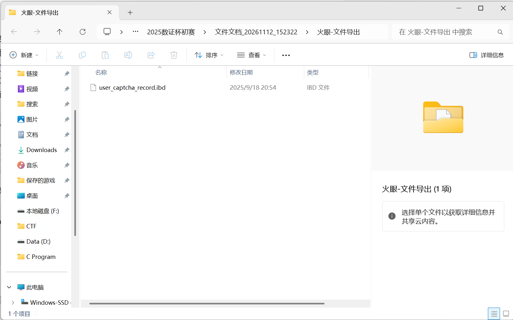
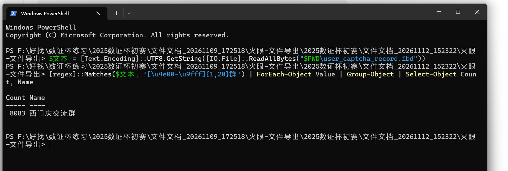

# Digital Forensics Case Study: 2025 Shuzheng Cup Preliminary

| | |
|---|---|
| **Event** | 2025 Shuzheng Cup preliminary (practice) |
| **Category** | Digital forensics — Linux servers, Docker, Kubernetes |
| **Tools** | GoldenEye Evidence Analysis V4, GoldenEye Simulation Forensics V4, VMware Workstation, PowerShell |
| **Scope** | Selected server-forensics questions (Q1–Q8 and Q11–Q12) |
| **Status** | Partial case study; Q6 uses an unverified reference answer |

This case study documents my training investigation of the 2025 Shuzheng Cup preliminary evidence. I focused on the server-forensics questions: identifying Linux hosts, interpreting system logs, distinguishing Docker and Kubernetes configuration, and connecting a container to its application data. The evidence consisted of an encrypted competition container holding separate forensic images. I imported the images into GoldenEye Evidence Analysis V4, examined Linux artifacts, and used a virtual machine for one runtime check.

This is a practice case study, not an official competition submission. The findings distinguish observations made during the exercise from answers taken from a reference write-up. Q12 includes screenshots of the exported filename and search output.

## Work log at a glance

| Stage | What I examined | Outcome |
|---|---|---|
| Evidence setup | Competition container and exported E01 images in GoldenEye | Separate Linux images became available for file and artifact analysis |
| Host identification | `/etc/hostname` and `/etc/hosts` | Identified `node1` and the master/node names used by the cluster |
| System activity | `/var/log/secure` and `/var/log/yum.log` | Distinguished a password change from a successful login, and an installation from an update |
| Runtime and deployment | A simulation of image 01 and Kubernetes YAML files | Checked the Docker proxy and deployment configuration; cluster API access failed |
| Container attribution | Docker artifacts in image 03 and application files in image 04 | Linked the `captcha-bot` container to Telegram bot configuration |

## Investigation steps and evidence handling

1. I created a GoldenEye case and imported the supplied competition container, using the password supplied with the training materials.
2. I browsed its first partition to `03-服务器取证` (server forensics), exported the relevant E01 images, and added them separately to the case.
3. I checked `/etc/hostname` before assigning a machine role to an image. I then followed the artifact path relevant to each question and recorded the answer format requested by the question.
4. For the disk-hash question, I used GoldenEye's hash operation on the selected evidence item. I did not substitute a hash of the compressed E01 file for a hash of the represented disk.

An E01 file is a forensic image container. The size of the E01 file can be much smaller than the source disk represented by it. A virtualized copy can help inspect a system interactively, but booting it changes its runtime state. In our exercise the simulation software also reset a user password. We therefore treated runtime output as a separate observation and recorded its limitations.

## Q1 — SHA-256 of node1's disk

**Question:** What are the first six hexadecimal characters of the SHA-256 hash of the node1 disk?

**Answer:** `FC9A34`.

We exported and imported `服务器检材02.E01`. The file `/etc/hostname` contained `node1`, identifying the machine. In GoldenEye, we selected that evidence item, used **Calculate Hash** on the evidence card, and selected SHA-256. The source disk was reported as 40 GB. The resulting source-disk SHA-256 began with `FC9A34`.

SHA-256 operates on the data read from the selected object. Renaming a file while preserving its bytes does not change its hash. When verifying an evidence copy, compare the full digest. The question asks for only the first six characters as an answer.

## Q2 — Number of node hosts in the supplied configuration

**Answer:** `2`, following the competition's reference-answer convention.

On node1, `/etc/hosts` listed three names: `master`, `node1`, and `node2`. Under the question's convention, `master` was counted separately and the two named node hosts were counted. A hosts file is a name-to-address configuration, so it alone does not establish that those machines were online or give a complete view of an active cluster.

## Q3 — Time of the master root password change

**Answer:** `09:35:59`.

We identified the master image by checking `/etc/hostname` and located the relevant record in `/var/log/secure`:

```text
Sep 19 09:35:59 master passwd: pam_unix(passwd:chauthtok): password changed for root
```

The record identifies the host, time, password-change operation and account. `chauthtok` refers to an authentication-token change. The log line gives no year or explicit time zone, and the question only asks for time of day.

To verify outside GoldenEye, export the `secure` log and run in PowerShell:

```powershell
Select-String -LiteralPath 'C:\path\to\exported\secure' -Pattern 'password changed'
```

This searches the exported file for matching lines. It is a second way to inspect the same log, rather than independent evidence of the event.

## Q4 — Docker installation date

**Answer:** `04月08日` (April 8).

The master's `/var/log/yum.log` contained an `Installed` record for `docker-ce` on `Apr 08` at `20:20:58`. A later `Updated` entry is a separate operation. The question asks for the date of installation, so the installation line is the relevant record.

## Q5 — Docker daemon proxy port

**Answer:** `4780`.

In the simulation of server image 01, the Docker service environment was queried with:

```bash
systemctl show --property=Environment docker
```

The trainee reported port `4780`, consistent with the provided reference write-up. The full command output was not retained in the conversation, so the exact variable and address should be checked against the evidence again before treating this as independently documented. The simulation software reset a password and the system was booted; runtime settings must be interpreted in that context.

## Q6 — MySQL external port

**Reference answer:** `30627` — not independently verified in this exercise.

The deployment file `/root/mysql-d.yaml` specified MySQL `containerPort: 3306`. `/root/mysql-services.yaml` specified a `NodePort` service with `port: 3306` but did not explicitly set a `nodePort`. Those files establish the internal/service configuration, but do not establish the externally allocated node port. A NodePort can be allocated by the cluster.

The attempted `kubectl get svc -A` could not reach the cluster API at the configured address. The reference write-up reports `30627`. Recover the original cluster's service state or another contemporaneous artifact before presenting this number as independently verified; do not infer it from `3306`.

## Q7 — Image used for the card-selling website

**Answer:** `webdevops/php-nginx`.

The deployment configuration `/root/php-nginx-deployment.yaml` contained:

```text
image: webdevops/php-nginx:7.4
```

The image name is `webdevops/php-nginx` and `7.4` is its tag. The requested answer format calls for the name. Preserve the full image reference in notes when the version matters.

## Q8 — Telegram moderation bot container ID

**Answer:** `8fadf5`.

In GoldenEye, examine server image 03 under **Analysis → Docker → Container list**. The relevant container name included `captcha-bot`; its container ID began `8fadf590`, so the first six characters are `8fadf5`. The answer matches the provided reference write-up. The parsed container record showed `ExitCode:255` and a recorded end time; distinguish the observed historical state from any present-day state after simulation.

To investigate the bot's identity, we followed its deployment configuration. The master file `/root/captcha-bot-d.yaml` named the container `captcha-bot`, mounted persistent storage at `/app`, and referenced the `captcha-bot` claim. Its claim configuration specified the NFS storage path `captchaBot`. In server image 04, `/data/k8s_data/default/captchaBot/config/config.toml` contained a Telegram configuration section and moderation/verification message templates. These artifacts associate the named workload and storage configuration with a Telegram moderation bot. A container name on its own would be weaker evidence. Avoid publishing tokens or passwords from the configuration.

The container log under `/var/log/containers` was a symbolic link to a pod log. The Docker JSON log under `/var/lib/docker/containers/<container-id>/` was paginated by GoldenEye. Searching the cached chunks for `telegram` did not find a direct match; the bot identity was instead supported by its configuration on image 04.

## Q11 — Telegram API proxy domain

**Answer:** `kk.xilika.cc`.

In server image 04, inspect `/data/k8s_data/default/captchaBot/config/config.toml`. The `api_proxy` field in the Telegram section contained an HTTP URL whose hostname is `kk.xilika.cc`. The answer asks for the domain, so omit the URL scheme. The same file contains a bot token; redact it when sharing screenshots or notes.

## Q12 — Which Telegram group did the verification bot serve?

**Recovered group name:** 西门庆交流群

On server image 04, I followed the MySQL data directory to `/data/k8s_data/default/mysql80/captchabot/user_captcha_record.ibd` and exported the table file. The database viewer listed a `telegram_chat_name` column, but its cells displayed `<BLOB>` and the detail view opened blank.



I opened PowerShell in the export folder. To look for a group name without knowing it in advance, I searched for one to twenty Chinese characters followed by 群 (“group”). I decoded the exported bytes as UTF-8 and grouped identical matches.

```powershell
$bytes = [IO.File]::ReadAllBytes("$PWD\user_captcha_record.ibd")
$text = [Text.Encoding]::UTF8.GetString($bytes)
[regex]::Matches($text, '[\u4e00-\u9fff]{1,20}群') | ForEach-Object Value | Group-Object | Select-Object Count, Name
```



The search returned one distinct name, 西门庆交流群, with 8,083 matches in the exported file. The count measures occurrences of the string. Determining the number of members or verification events would require examining individual database records.

## Dead ends and corrections

- The file tree initially led me into unallocated space and repeated `var` directories. I had to select the Linux filesystem partition before following the real `/var/log` path.
- Searching `/var/log/secure` for `password` first surfaced a successful SSH login. That record did not answer the password-change question; the relevant marker was `passwd:chauthtok`.
- GoldenEye paginated a large container log, and its visible search did not produce a Telegram match. The deployment manifest, storage mapping, and application configuration provided the stronger attribution chain.
- Booting a forensic copy did not restore a working Kubernetes API. I could read YAML configuration, but I could not verify the allocated MySQL NodePort from the original cluster state.

## Remaining verification

- Retain the full Docker service environment output for Q5, including the variable and address containing port `4780`.
- Verify Q6's external MySQL NodePort from original cluster state or another contemporaneous artifact before presenting `30627` as my own finding.
- Q9 and Q10 were outside this practice session and are intentionally absent from this write-up.

## Takeaways

- Record the evidence image, artifact path, relevant field and question-specific answer format.
- Distinguish a container ID from an image name, and an image name from its tag.
- Check whether a log entry records a login, password change, installation, or update before extracting its timestamp.
- Follow symbolic links to their target when the preview shows a path instead of the expected content.
- Separate a configured container port, service port and externally assigned NodePort.
- Treat simulation output and third-party write-ups as leads to verify against original evidence.
